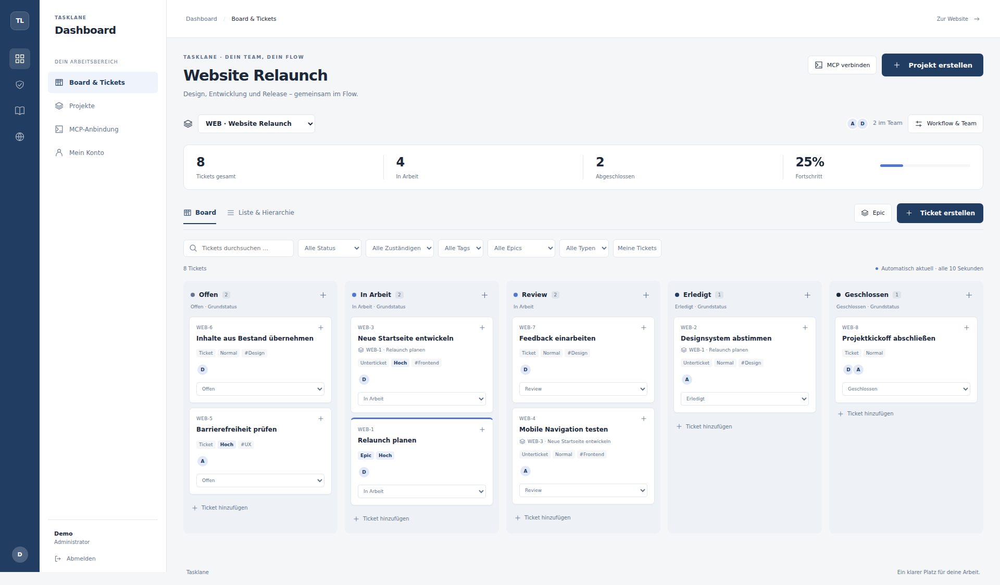
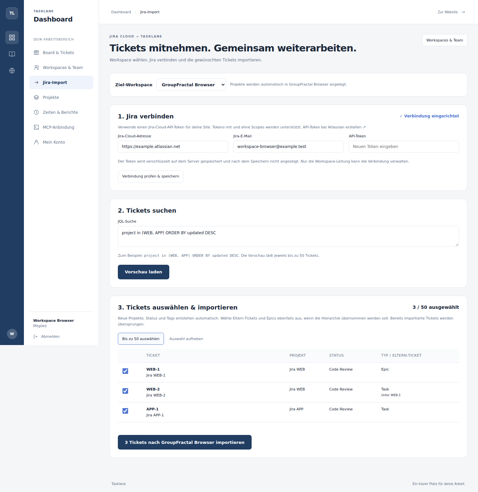

# Tasklane

[](https://github.com/NavidPMB/tasklane/actions/workflows/ci.yml)
[](LICENSE)

**A small, self-hosted ticket manager with MCP built in.**

Manage projects, epics and tickets in your browser—or let an MCP assistant work with the same data. Tasklane keeps board columns, dropdowns and MCP tools in sync with your project's workflow.

Built with **Django, Next.js and PostgreSQL**. The interface is currently in **German**. Email/password login works immediately after you create your own account; Google login is optional.



## What you can do

- Organize projects in shared workspaces, with inherited team access across all current and future projects.
- Bring completed ClickUp tasks with their full historical time entries into Tasklane, including former contributors and exact durations.
- Import selected Jira Cloud tickets with encrypted credentials, JQL previews and automatic project creation.
- Create multiple projects with separate tags, workflows and optional project-only guests.
- Organize work into epics, tickets and nested subtickets.
- Assign multiple teammates, add tags, set priorities and due dates.
- Switch between a drag-and-drop board and a hierarchical list.
- Log time per ticket with a work date, duration and note; edit your own entries.
- Report time per person, project, ticket and day, filter by period, and export CSV.
- Search and combine filters for status, assignee, tag, epic and ticket type.
- Start with four status categories: **Open → In progress → Done → Closed**.
- Insert and reorder custom statuses within those categories. Board columns, selectors and MCP use the same live status list.
- Connect a local MCP client to **40 tools** for projects, members, tickets, tags and statuses.
- Use the built-in wiki with public, member-only and superuser-only articles.

## Quick start

### Requirements

- Linux, macOS, or Windows through **WSL2**.
- **Python 3.12+**, including the `venv` module.
- **Node.js 20.9+** and npm; Node.js 22 is used in CI.
- **Docker** with Docker Compose, running locally.
- Git and Make.

On Ubuntu/WSL, `python3-venv` provides the Python virtual environment module.

### 1. Clone and install

```bash
git clone https://github.com/NavidPMB/tasklane.git
cd tasklane
make setup
```

This generates a private `.env` with random secrets, installs pinned dependencies, starts PostgreSQL and runs database migrations. Existing `.env` files are preserved.

### 2. Create your account

Run this in an **interactive terminal** and choose your email and password:

```bash
make user
```

This creates a local administrator. There are **no default accounts or shared passwords** in this repository. Administrators can add more users through `/django-admin/`.

### 3. Start Tasklane

```bash
make dev
```

Open **[http://localhost:3010/login](http://localhost:3010/login)**, sign in with the account you just created, and create your first workspace and project.

`make dev` starts the backend and frontend together. **Ctrl+C stops both**. PostgreSQL keeps running so MCP clients can continue to use it. To stop the database too:

```bash
make stop
```

Data stays in the local Docker volume and is available the next time you run `make dev`.

## Connect an MCP assistant

Tasklane ships a **local stdio MCP server**. Your MCP client launches it as a subprocess. It uses the same PostgreSQL database and project permissions as the website. The web servers can be stopped; the database must be running.

### Generate a configuration

Use the email of the account you created:

```bash
make mcp-config MCP_EMAIL=you@example.com
```

This prints a `mcpServers` JSON configuration with **absolute paths for your checkout**. Copy the `tasklane` entry into a client that accepts this format. If your client uses another configuration format, use the same command, arguments and environment variable.

Example output, with paths to replace:

```json
{
  "mcpServers": {
    "tasklane": {
      "command": "/absolute/path/to/tasklane/.venv/bin/python",
      "args": ["/absolute/path/to/tasklane/backend/mcp_server.py"],
      "env": {
        "TASKLANE_MCP_USER_EMAIL": "you@example.com"
      }
    }
  }
}
```

You can also get a ready-to-copy configuration after logging in at **`/dashboard/mcp`**.

### Verify the connection

```bash
make db
make mcp-check MCP_EMAIL=you@example.com
```

The check performs MCP initialization, discovers the tools and makes a read-only `list_projects` call. An empty project list is fine:

```text
MCP OK: 40 tools discovered, 0 accessible projects.
```

The server needs an **existing active account**. It rechecks account status and project access on every call. The email selects the account for a trusted local process; it is not a remote authentication token. This release does not expose an HTTP MCP endpoint.

### Things to ask your assistant

- “List my projects and show their open tickets.”
- “Create a project called Website with the key WEB.”
- “Create an epic for the relaunch and add three subtickets.”
- “Add a Review status after In progress, then move WEB-3 into it.”
- “Assign WEB-3 to a project member and add the Frontend tag.”

Ask the assistant to call `list_projects` and `get_project` or `list_statuses` first. Status, member, tag and ticket IDs belong to a specific project and should be read from the live data.

### Available tools

| Area | Tools |
| --- | --- |
| Workspaces | `list_workspaces`, `create_workspace`, `get_workspace`, `update_workspace`, `add_workspace_member`, `remove_workspace_member` |
| ClickUp | `get_clickup_connection`, `configure_clickup`, `list_clickup_locations`, `preview_clickup`, `prepare_clickup_import`, `import_clickup` |
| Jira Cloud | `get_jira_connection`, `configure_jira`, `preview_jira`, `import_jira` |
| Projects | `list_projects`, `get_project`, `create_project`, `update_project` |
| Team | `add_project_member`, `remove_project_member` |
| Workflow | `list_statuses`, `create_status`, `update_status`, `delete_status` |
| Tags | `create_tag`, `update_tag`, `delete_tag` |
| Tickets | `list_tickets`, `get_ticket`, `create_ticket`, `update_ticket`, `delete_ticket` |
| Time tracking | `create_time_entry`, `update_time_entry`, `delete_time_entry`, `list_time_entries`, `get_time_report`, `export_time_report` |

`create_ticket` with `kind: "epic"` creates an epic; `parent_id` creates a hierarchy. `assignee_ids` and `tag_ids` replace the corresponding lists. `list_tickets` supports search, filters and pagination.

Browser changes are refreshed immediately after saving. Changes from another client—including MCP—are fetched every **10 seconds** while the page is active, and when the window regains focus.

## Shared workspaces and Jira Cloud import

Open **Workspaces & Team**, create a workspace such as **GroupFractal**, and add a teammate's existing Tasklane account by email. Workspace members can access all existing and future projects in it. Project-only sharing is also supported. Removing workspace access preserves any separate project memberships and ownership.

Open **Jira-Import**, select the workspace and enter your `https://team.atlassian.net` URL, Jira email and API token. Tokens with and without scopes are supported; scoped tokens need the read permissions required by the Jira profile and issue-search APIs. Credentials are verified and stored through the central encrypted integration model. Only the workspace owner can manage and use the Jira connection. No Jira credentials are needed to run Tasklane itself.

Search with JQL, for example `project in (WEB, APP) ORDER BY updated DESC`, preview the results, and select up to **50 tickets per import**. Tasklane creates the corresponding projects inside the selected workspace and imports ticket text, epics, available parent relationships, statuses, labels, priorities and due dates. Jira assignees are matched only to existing project members by email; unresolved assignments or parents produce warnings. The ticket details retain a link to Jira.

Imports are atomic and repeatable: existing imported issues are skipped, preserving local edits. This is a one-time import; attachments, comments, Jira worklogs and ongoing synchronization are outside its scope. Existing projects are migrated into personal workspaces without broadening their original sharing. Project keys are unique within a workspace, so use workspace and project IDs when an MCP request could be ambiguous.



See the [workspace and Jira guide](docs/workspaces-jira.md), also available at `/wiki/tasklane-workspaces-jira` after signing in. Atlassian documents [API-token setup](https://support.atlassian.com/atlassian-account/docs/manage-api-tokens-for-your-atlassian-account/) and [JQL search](https://developer.atlassian.com/cloud/jira/platform/rest/v3/api-group-issue-search/).

## ClickUp import with historical time tracking

Open **ClickUp-Import**, choose the target Tasklane workspace and save your personal ClickUp API token. Browse the source workspace, Space, folder and list, then select up to **20 tasks per import**, including completed tasks and subtasks. Selection can span multiple lists; lists become projects automatically. Archived locations and tasks can also be selected.

**Tickets & gesamte Zeithistorie prüfen** fetches all available historical time entries, explicitly including previous years and team contributors. It compares each task's individual bookings with ClickUp's reported time total. Missing permissions, mismatches or running timers stop the import before local tickets are created. The review shows people, dates and total time; the verified snapshot remains available for 30 minutes.

Your ClickUp account needs Workspace Owner/Admin access to retrieve other people's time entries, as documented in the [ClickUp time API](https://developer.clickup.com/reference/gettimeentrieswithinadaterange). Tokens are verified and stored in the central encrypted credential model. Only the Tasklane workspace owner can configure and perform imports.

**Tickets und Zeiten importieren** saves the reviewed snapshot atomically. Original durations are preserved in milliseconds, along with the original contributor, start-date attribution and notes. Matching active project members are linked by email. Former or unknown people remain historical contributors without creating accounts or granting access. Imported bookings are read-only source history.

Repeated imports skip existing tasks and time-entry IDs, and can add missing new bookings without overwriting local ticket edits. Changed previously imported source bookings produce a conflict instead of silently changing history. **Importierte Zeithistorie im Bericht öffnen** opens the correct historical date range, with time per original person, project, ticket and day. CSV also includes exact milliseconds and source details. Tasks and times in ClickUp remain available; this is a copy, not continuous synchronization.

See the [ClickUp user guide](docs/clickup-import.md), `/wiki/tasklane-clickup-import`, and the [technical guide](docs/development/clickup-import.md). No ClickUp credentials are required for running Tasklane itself.

## Time tracking and team reports

Open a ticket or epic and choose **Zeit erfassen** to book your own work time. Enter the date, hours, minutes and an optional note. Entries are manual, between 1 minute and 24 hours, and can be booked for today or a past day. Ticket cards show their total logged time.

Use **Zeiten & Berichte** in the dashboard to see how much each person worked. Filter by workspace, project, person and inclusive date range; the default is month-to-date across your accessible projects. Reports group time by person, project, ticket and day. The **CSV export** includes all matching entries, even when the on-screen list spans multiple pages.

Only the person who booked an entry can edit or delete it. Project members can read their team's entries. Bookings stay in reports when a member leaves; tickets with logged time are kept instead of being deleted. Subticket time belongs to that subticket and is not double-counted in its parent epic.

MCP supports the same workflow: `create_time_entry` (duration as integer `minutes`, date as `YYYY-MM-DD`), `update_time_entry`, `delete_time_entry`, `list_time_entries`, `get_time_report`, and `export_time_report`. Reports without a project filter cover only projects the connected account can access. Example: “Book 90 minutes on WEB-3 today, then show this month's total per person.”

See the [time tracking guide](docs/time-tracking.md) or `/wiki/tasklane-arbeitszeit` after signing in.

## Configuration

Defaults are defined in `.env.example` and copied into your ignored `.env` by setup:

| Service | Local address |
| --- | --- |
| Website | `http://localhost:3010` |
| Django backend | `http://127.0.0.1:8010` |
| PostgreSQL | `127.0.0.1:5440` |

If ports are occupied, edit `.env` **before** starting the services. Keep these settings aligned:

| Change | Also update |
| --- | --- |
| `FRONTEND_PORT` | `PUBLIC_URL`, `DJANGO_CSRF_TRUSTED_ORIGINS` |
| `BACKEND_PORT` | `BACKEND_URL` |
| `POSTGRES_PORT` | `DATABASE_URL` |

For another independent checkout, run `python3 scripts/init_env.py --slug another_project` before the first setup and choose different ports.

### Optional Google login

Email/password login does not need Google credentials. To enable Google, use **Django Admin → Integrations & credentials → Google Login**, save your own OAuth client ID and secret, and activate it. For the default local setup, the callback is:

```text
http://localhost:3010/accounts/google/login/callback/
```

See the [Google setup guide](docs/development/google-login-live.md) for details. Google accounts are not automatically linked to existing accounts solely because they share an email address. Integration secrets are encrypted in PostgreSQL; keep `CREDENTIAL_ENCRYPTION_KEY` with your private backups.

## Development

```bash
make test    # PostgreSQL-backed backend tests, including real MCP stdio calls
make check   # Django checks, migration checks and a Next.js production build
```

You can run the servers separately with `make backend` and `make frontend`. Stop a running Next.js server before a production build; development and production share the `.next` directory. After `make check`, a local production frontend can be run with `cd frontend && npm start` while `make backend` runs separately.

```text
backend/
  accounts/           Email/password login and optional Google login
  core/               Sessions, health checks and access control
  integrations/       Encrypted integration credentials
  modules/work/       Projects, workflow, tags, tickets and shared MCP/API logic
  modules/wiki/       Articles with audience-based access
  mcp_server.py       Local stdio MCP server
frontend/src/
  app/                Public pages, dashboard, admin and wiki
  components/work/    Board, hierarchy, forms and workflow settings
  config/             Branding and navigation
scripts/              Setup, combined dev server and MCP helpers
```

The browser API and MCP server share the same validation and project access rules. The workspace owner manages workspace sharing, Jira and ClickUp; project and workspace owners manage project settings. Effective project members manage tickets, statuses and tags. Staff privileges alone do not grant access to other people's projects.

More documentation: [user guide](docs/tasklane-guide.md), [developer guide](docs/DEVELOPMENT.md), [MCP internals](docs/development/tasklane-mcp.md), and [contributing](CONTRIBUTING.md). Detailed in-app documentation and the current interface are in German.

## Current scope

Tasklane is a small local-first application. The project snapshot loads all tickets in that project; the MCP ticket search is paginated. Live updates use polling. Attachments, comments, email invitations, password-reset delivery, HTTP MCP and production deployment automation are not included.

The supplied Django development server and Compose database are intended for local use. Internet-facing deployments require their own HTTPS proxy, production application server, backups and shared rate-limit cache. See [development documentation](docs/DEVELOPMENT.md).

## License

[MIT](LICENSE). Use it, change it, self-host it, and make it your own.
